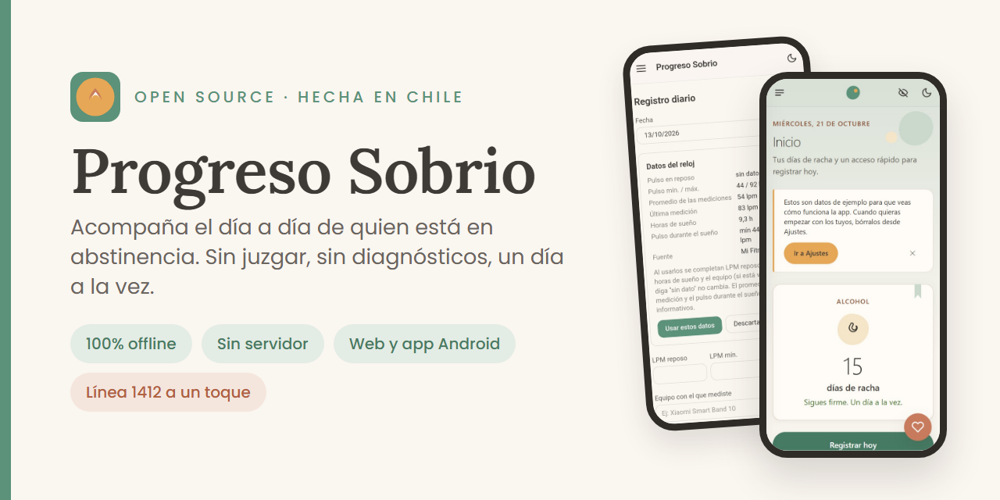
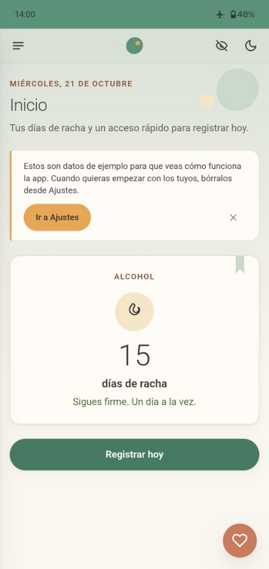
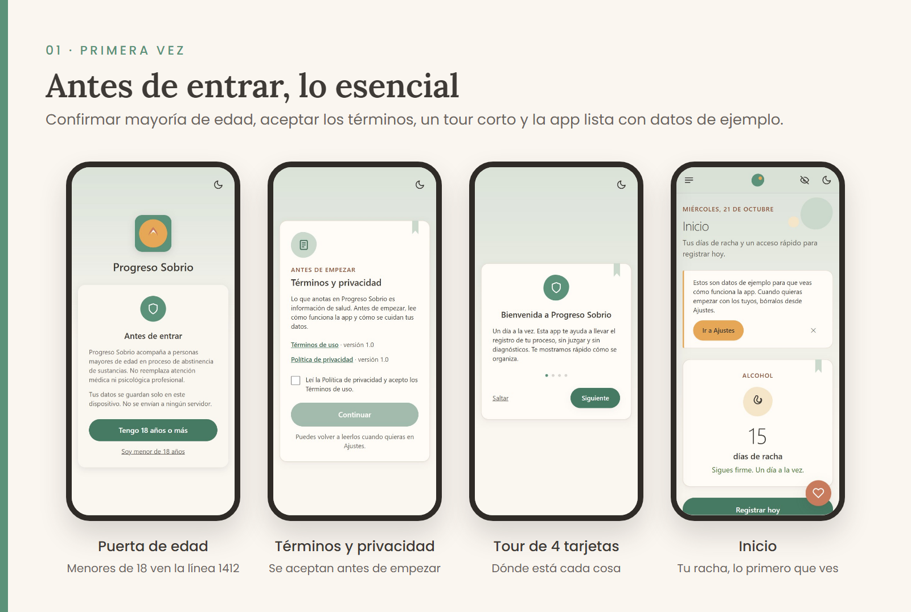
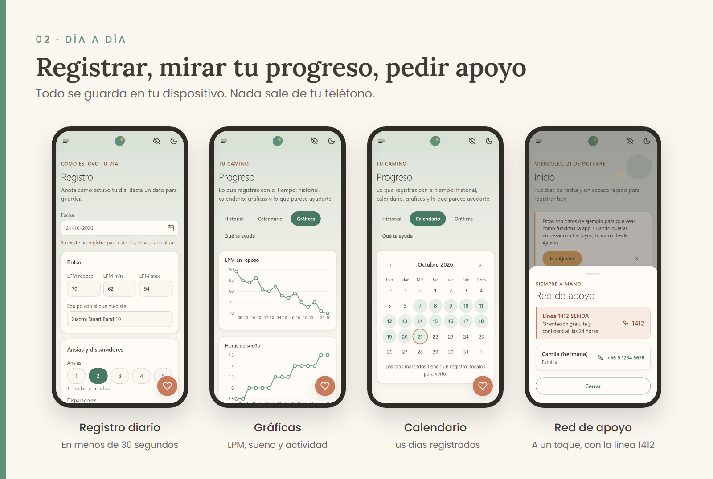
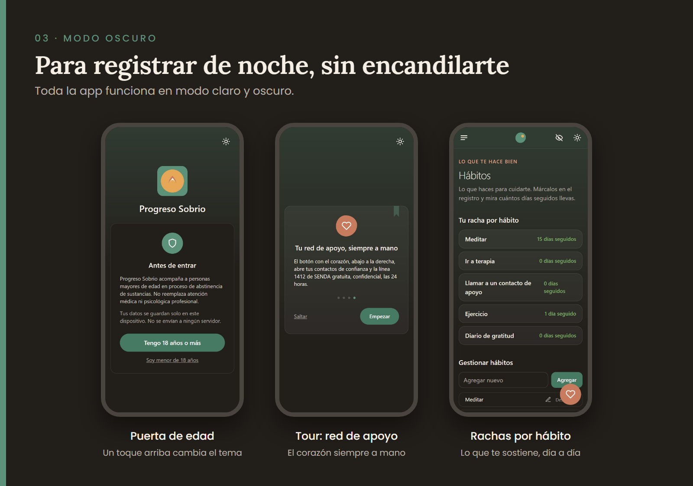
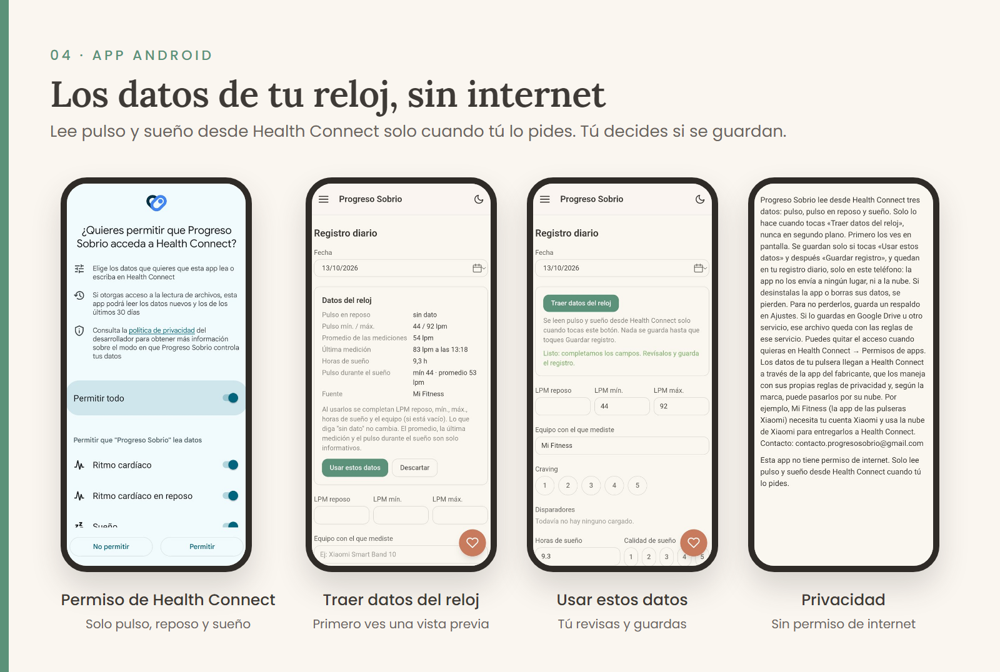

# Progreso Sobrio

<p align="center">

</p>

Acompaña el día a día de una persona en proceso de abstinencia de sustancias, sin juzgar, sin dar diagnósticos, un día a la vez.

> Progreso Sobrio es para personas mayores de 18 años y no reemplaza atención médica ni psicológica profesional. Si estás en crisis, comunícate con la línea **1412** de SENDA (Chile), gratuita y confidencial las 24 horas.

**Sitio oficial:** [progresosobrio.cl](https://progresosobrio.cl) · **App web:** [app.progresosobrio.cl](https://app.progresosobrio.cl) — al abrirla por primera vez ves datos de ejemplo, para que puedas explorar la app antes de cargar los tuyos.

**¿Usas la app o acompañas a alguien en recuperación?** Tu opinión guía lo que viene. Cuéntanos en este [formulario anónimo](https://docs.google.com/forms/d/e/1FAIpQLSc9oG92I_hm_MhiHEwnJEDB-SFooflUpTM7wKmFU1tYlNSeIQ/viewform) (no pedimos nombre ni correo).

[](https://docs.google.com/forms/d/e/1FAIpQLSc9oG92I_hm_MhiHEwnJEDB-SFooflUpTM7wKmFU1tYlNSeIQ/viewform)

## Privacidad primero

- **100% offline** una vez cargada, funciona sin conexión a internet.
- **Sin backend, sin servidor externo.** Todos los datos se guardan solo en tu dispositivo: en tu navegador (IndexedDB) o dentro de la app Android.
- **Sin analytics, sin llamadas de red con tus datos.** Nada sale de tu dispositivo. La app Android ni siquiera tiene permiso de internet.
- Tus datos son tuyos: puedes exportarlos e importarlos cuando quieras.

Pruébalo tú: instala la app, activa el modo avión y ábrela. Funciona igual.

El detalle está en la [política de privacidad](https://progresosobrio.cl/privacidad.html) y los [términos de uso](https://progresosobrio.cl/terminos.html).

<p align="center">

</p>

## Qué hace

- **Tour de bienvenida**, una sola vez, antes de entrar por primera vez: te explica en 4 tarjetas cortas dónde está el registro diario, dónde ver tu progreso, y que tu red de apoyo está siempre a un toque en el ícono de corazón.
- **Racha de sobriedad** por sustancia, lo primero que ves al abrir la app, y puedes tener varias en paralelo.
- **Registro diario en menos de 30 segundos**: LPM (latidos por minuto) en reposo, ansias, sueño, actividad física, energía, ánimo, hábitos cumplidos, disparadores y notas. Basta un dato para guardar el día.
- **Historial** en tarjetas y calendario, editable.
- **Gráficas** de LPM en reposo, sueño y actividad a lo largo del tiempo.
- **Panel "Qué te ayuda"**: correlaciones simples en lenguaje llano, nunca un diagnóstico.
- **Rachas de cumplimiento por hábito.**
- **Respaldo completo** en un archivo JSON que puedes restaurar cuando quieras, y **tus registros en CSV** para abrirlos en Excel o Sheets.
- **Red de apoyo** siempre a un toque: tus propios contactos + la línea 1412 de SENDA.
- **Pantalla de privacidad**: el ojo tachado, arriba a la derecha, tapa toda la app con una pantalla neutra. En Ajustes puedes hacer que se tape sola cada vez que sales.
- **Traer datos del reloj** (solo en la app Android): pulso y sueño desde Health Connect, con una vista previa antes de usarlos en tu registro.

## App Android

Además de la versión web, hay una app para Android 9 o superior. Es la misma app, empaquetada para funcionar sin internet, y además puede traer el pulso y el sueño de tu reloj desde Health Connect. Descarga el APK desde la [última versión en GitHub Releases](https://github.com/VictoriaMolinaC/progreso-sobrio/releases/latest).

**Instalar**

1. Descarga el archivo `.apk` de la versión en tu teléfono.
2. Ábrelo. Android te va a pedir que permitas instalar apps desde esa fuente (tu navegador o el gestor de archivos).
3. Para traer datos del reloj necesitas Health Connect: desde Android 14 viene incluido; en Android 13 o inferior se instala desde Play Store.

**Privacidad**

- **No tiene permiso de internet:** Android no la deja conectarse a nada.
- Solo lee tres datos de Health Connect (pulso, pulso en reposo y sueño), y solo cuando tocas «Traer datos del reloj». Primero ves una vista previa; nada se guarda hasta que tú lo decides.
- No se copia a la nube de Google ni a otro teléfono: la copia de seguridad del sistema y el traspaso entre teléfonos están desactivados.
- Los datos de tu pulsera llegan a Health Connect a través de la app del fabricante, con sus propias reglas, y según la marca pueden pasar por su nube. Por ejemplo, Mi Fitness (pulseras Xiaomi) necesita tu cuenta Xiaomi y usa la nube de Xiaomi para entregarlos a Health Connect. Sin pulsera, la app funciona igual.

**Respaldo: importante**

Tus datos viven solo en el teléfono. **Si desinstalas la app o borras sus datos, se pierden.** Guarda un respaldo seguido en Ajustes → «Descargar respaldo completo» y, si cambias de teléfono o reinstalas, recupéralo con «Restaurar un respaldo». El mismo archivo sirve en la versión web.

**Verificar el APK (opcional)**

El APK oficial está firmado con esta huella SHA-256:

```
61:DB:E2:B9:43:4C:1F:46:10:99:D4:86:CD:7E:4A:4B:88:88:61:F1:1D:12:8F:25:3A:78:31:FC:A4:D9:91:FC
```

Puedes revisarla con `apksigner verify --print-certs <archivo.apk>` (viene con el SDK de Android). Si no coincide, no lo instales.

**Compilarla tú**

```bash
pnpm build:android && pnpm copy:android
cd android
./gradlew assembleDebug   # en Windows: .\gradlew.bat assembleDebug
```

Una app que compiles tú queda con otra firma: Android no la deja instalarse encima de la oficial (habría que desinstalar, y eso borra los datos).

## Por qué existe

No encontramos una app chilena dedicada a esto. Lo más cercano es la línea/chat 1412 de SENDA y "PlanSobrio", una app de encuentro social para gente sobria en Latinoamérica, pero con otro propósito (no es un tracker diario).

Progreso Sobrio se diferencia por ser open source, una PWA instalable y una app Android que funcionan sin conexión, con profundidad real de correlación entre LPM, sueño, ansias y ánimo, soporte para varias sustancias en paralelo, e integración directa con la red de apoyo chilena.

## Por qué no tiene IA

Un contribuidor propuso agregar un agente de IA para resolver dudas y armar recordatorios ([discusión #47](https://github.com/VictoriaMolinaC/progreso-sobrio/discussions/47)). Decidimos que no, por dos razones:

- **Privacidad:** un agente casi siempre envía lo que escribes a un servidor externo, y eso rompe la promesa de que nada sale de tu dispositivo.
- **Seguridad:** quien usa la app puede estar en su peor día. Ahí la app no improvisa: deriva a la línea 1412 de SENDA.

La parte de los recordatorios sí calzaba, así que la convertimos en el [issue #48](https://github.com/VictoriaMolinaC/progreso-sobrio/issues/48): un recordatorio diario 100% offline, con un texto discreto. ¿Tienes otra mirada? Súmate a la conversación en las [Discusiones](https://github.com/VictoriaMolinaC/progreso-sobrio/discussions).

## Capturas

<p align="center">

</p>

<p align="center">

</p>

<p align="center">

</p>

<p align="center">

</p>

## Stack técnico

Vite + React + TypeScript, Tailwind CSS, [Dexie.js](https://dexie.org/) sobre IndexedDB para todo el almacenamiento local, y Recharts para las gráficas. Gestor de paquetes: pnpm.

La app Android (carpeta `android/`) es un envoltorio nativo en Kotlin: muestra la misma PWA en un WebView, sin permiso de internet, y lee pulso y sueño desde [Health Connect](https://developer.android.com/health-and-fitness/guides/health-connect).

Las imágenes de este README se generan con las plantillas de [`.github/imagenes/`](./.github/imagenes/COMO-GENERAR.md).

## Correr el proyecto localmente

```bash
git clone https://github.com/VictoriaMolinaC/progreso-sobrio.git
cd progreso-sobrio
pnpm install
pnpm dev
```

## Cómo contribuir

Lee detalladamente el documento [CONTRIBUTING.md](./CONTRIBUTING.md) para el flujo de trabajo y cómo levantar el entorno.

¿Buscas tu primera contribución open source? Revisa los issues con la etiqueta [`good first issue`](https://github.com/VictoriaMolinaC/progreso-sobrio/issues?q=is%3Aopen+label%3A%22good+first+issue%22).

## Apoyar el proyecto

Si Progreso Sobrio te sirve y puedes aportar, ayudas a sostener el proyecto. Basta con dejar una estrella ⭐ o participar en las [Discusiones](https://github.com/VictoriaMolinaC/progreso-sobrio/discussions).

## Cuéntanos tu experiencia

Si Progreso Sobrio te ayudó, puedes contarlo de forma **completamente anónima** (no pedimos nombre ni correo) en [este formulario](https://docs.google.com/forms/d/e/1FAIpQLSc9oG92I_hm_MhiHEwnJEDB-SFooflUpTM7wKmFU1tYlNSeIQ/viewform). Si prefieres escribir directamente, puedes hacerlo a **contacto.progresosobrio@gmail.com**.

[](https://docs.google.com/forms/d/e/1FAIpQLSc9oG92I_hm_MhiHEwnJEDB-SFooflUpTM7wKmFU1tYlNSeIQ/viewform)

## Autora

Proyecto creado por **Victoria Molina**, desarrolladora full stack en Chile.

[LinkedIn](https://www.linkedin.com/in/victoriamolinac) · [GitHub](https://github.com/VictoriaMolinaC)

## Seguridad

¿Encontraste una vulnerabilidad? No abras un issue público: sigue los pasos de [SECURITY.md](./SECURITY.md).

## Licencia

El código es [MIT](./LICENSE). El nombre «Progreso Sobrio» y el logo no forman parte de la licencia: si publicas una versión modificada, usa otro nombre y otro logo, para que nadie la confunda con la app oficial.
